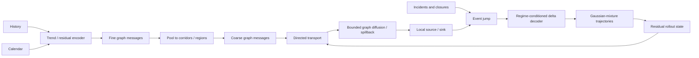

# DAGNN + PI-STNet v3: независимая исследовательская реализация

`dagnn_pistnet_v3` — новый пакет. Он использует проверенные адаптеры данных v2,
но не изменяет модель, trainer, checkpoint или результаты `dagnn_pistnet`.

## Семь перенесённых рекомендаций

| № | Механизм | Реализация | Статус на текущих данных |
|---:|---|---|---|
| 1 | Delta decoder, rollout curriculum, semigroup | `model.py`, `training.py` | активен |
| 2 | Fine/coarse дорожный граф | `graph.py`, `MultiScaleGraphBlock` | активен |
| 3 | Transport–diffusion–source operator splitting | `modules.py` | активен; data-driven |
| 4 | Cross-dataset masked pretraining | `pretraining.py` | отдельная обязательная стадия study |
| 5 | Мультимодальный вероятностный прогноз | `ForecastDistribution`, GMM NLL/CRPS | активен |
| 6 | Дискретный event jump | `EventJumpOperator` | код активен, воздействие нулевое без event data |
| 7 | Conservation-by-construction | `ConservativeEdgeFlux` | заблокирован guards без density/flow/volume |

## Поток модели

### Приращения и rollout

Каждая mode-голова прогнозирует

\[
\hat x_{t+1}^{(k)} = \hat x_t + \Delta_\theta^{(k)}.
\]

Во время обучения длина собственного rollout возрастает от
`curriculum_start_steps` до полного горизонта. Teacher forcing не используется.
Semigroup-loss сравнивает вторую половину прямого прогноза с повторным запуском
модели из состояния на середине горизонта.

### Иерархия

Если реальные corridor/region ids не переданы, кластеры строятся BFS по topology.
Индексы датчиков никогда не трактуются как пространственная координата. На
LargeST граф обрабатывается локальными node partitions, а дальний обмен — через
малое число coarse nodes.

### Operator splitting

Три обучаемых оператора применяются последовательно:

1. направленный edge-conditioned transport;
2. bounded Laplacian term для spatial diffusion/spillback;
3. локальный source/sink, обусловленный календарём и событиями.

На flow-only датасетах это индуктивная структура, а не заявленный закон физики.

### Вероятностный выход

Выход содержит `K` согласованных траекторий, масштабы и logits:

- `means`: `[B,P,N,K,F]`;
- `scales`: `[B,P,N,K,F]`;
- `logits`: `[B,P,N,K]`.

Обучение использует Gaussian-mixture NLL; оценка — point metrics, exact mixture
CRPS, NLL, coverage и ширину 80/95% интервалов. Oracle best-of-K не используется.

### Жёсткое сохранение

`ConservativeEdgeFlux` вычисляет поток на ориентированных рёбрах и обновляет
плотность incidence-балансом. Внутренние потоки попарно сокращаются, поэтому
изменение полной массы равно только boundary flow. Конфигурация отклоняется до
запуска, если отсутствуют независимо измеренные density/flow, directed topology
или положительный control volume каждого узла.

## Масштабирование

Модель не содержит `N × N` trainable tensors. Основные spatial операции имеют
стоимость `O(BEhidden)`; coarse graph ограничен `max_clusters`. Для LargeST
`node_batch_size` создаёт детерминированные locality-preserving partitions.

## Ограничения текущей версии

- Topological clustering слабее реальных corridor identifiers.
- GMM предполагает условно независимые скалярные Gaussian-компоненты при общей
  mode probability; совместная covariance пока не моделируется.
- Event jump нельзя оценить без timestamped incidents/closures.
- Hard conservation нельзя оценить на пяти текущих benchmark-датасетах.
- Operator splitting требует отдельной абляции и не гарантирует улучшение.
